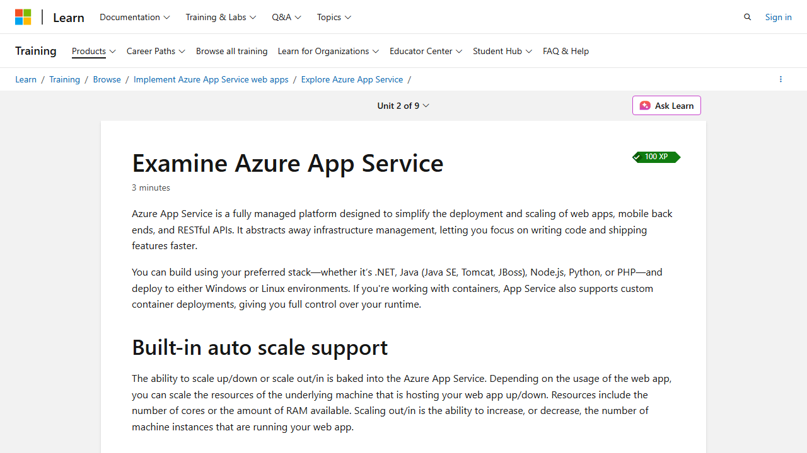
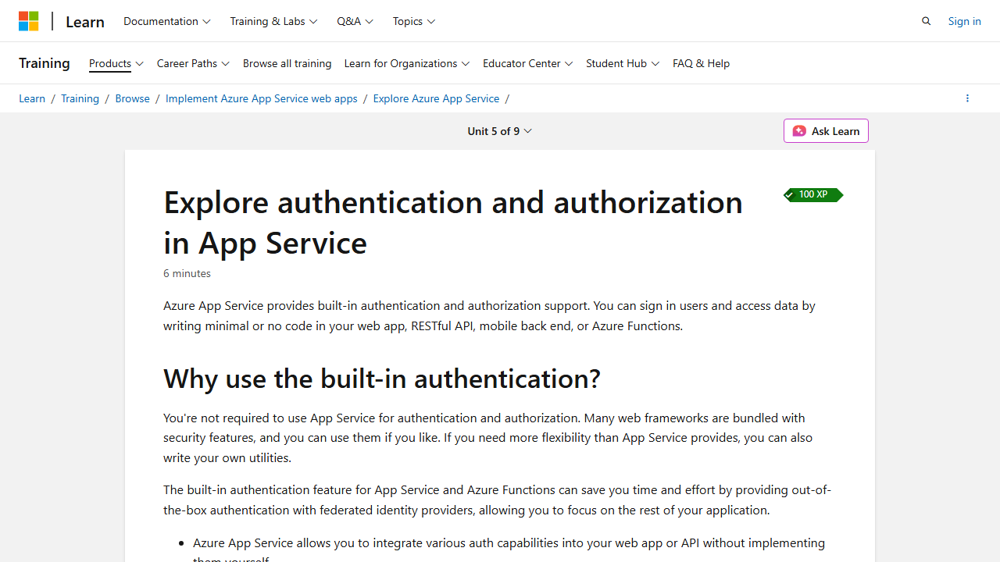
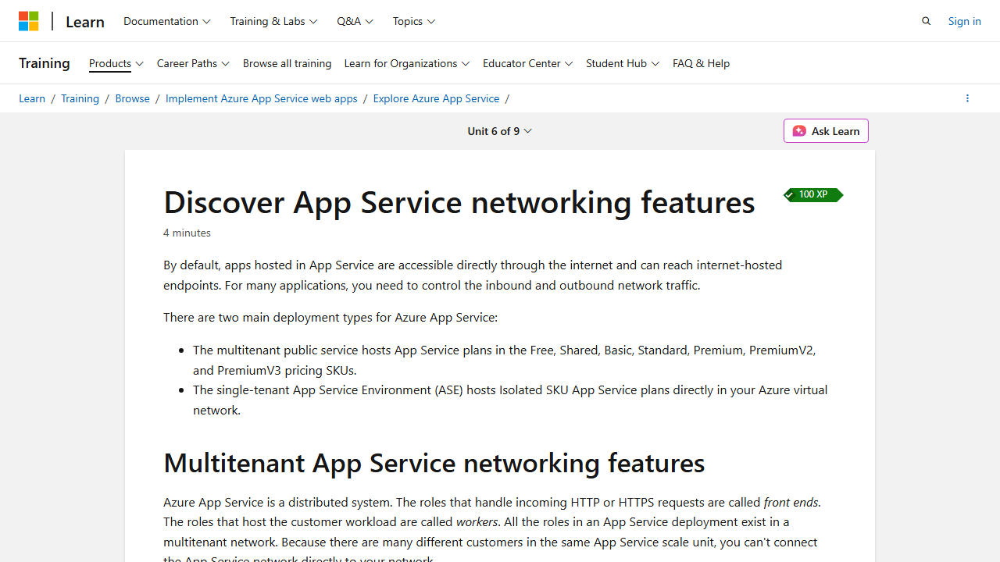

# Explore Azure App Service

> **Module 1** of the *Implement Azure App Service Web Apps* learning path  
> **Duration:** 44 min · 9 Units  
> **Source:** [Microsoft Learn](https://learn.microsoft.com/en-us/training/modules/introduction-to-azure-app-service/)

---

## 1. What is Azure App Service?

Azure App Service is a **fully managed platform** for hosting web apps, REST APIs, and mobile back ends. It abstracts away infrastructure management so you can focus on code.

- **Supported stacks:** .NET, Java (SE, Tomcat, JBoss), Node.js, Python, PHP
- **Deployment targets:** Windows or Linux environments
- **Container support:** Custom containers from Azure Container Registry or Docker Hub; multi-container apps via Docker Compose



### Key Built-in Capabilities

| Feature | Description |
|---|---|
| **Auto Scale** | Scale up/down (change VM size) or scale out/in (change instance count) based on usage |
| **CI/CD** | Built-in integration with Azure DevOps, GitHub, Bitbucket, FTP, local Git |
| **Deployment Slots** | Separate staging environments (Standard tier+); swap slots with zero downtime |
| **Container Support** | Windows & Linux containers; pull from ACR or Docker Hub |

### App Service on Linux

- Supports built-in images for .NET Core, Java, Node.js, Python, PHP
- Deploy custom containers if your runtime isn't built-in
- Use `az webapp list-runtimes --os-type linux` to see available runtimes

**Limitations:**
- Not supported on **Shared** pricing tier
- Portal shows only features currently available for Linux
- Built-in images use Azure Storage-backed volumes (higher latency than container filesystem)

### App Service Environment (ASE)

- Fully **isolated and dedicated** environment for running App Service apps
- Compute resources are dedicated to a single customer (vs. shared in regular App Service)
- Provides improved security at high scale

---

## 2. App Service Plans

An **App Service plan** defines the compute resources for your web app. One or more apps can share the same plan.

Each plan specifies:
- **Operating System** (Windows / Linux)
- **Region** (e.g., West US, East US)
- **Number of VM instances**
- **Size of VM instances** (e.g., P1v3, P2v3)
- **Pricing tier**

### Pricing Tier Categories

| Category | Tiers | Description |
|---|---|---|
| **Shared compute** | Free, Shared | Apps share VMs with other customers. CPU quotas. No scale-out. Dev/test only. |
| **Dedicated compute** | Basic, Standard, Premium, PremiumV2, PremiumV3 | Apps run on dedicated VMs. Same plan = same compute. Higher tier = more scale-out instances. |
| **Isolated** | Isolated, IsolatedV2 | Dedicated VMs on dedicated VNets. Network + compute isolation. Maximum scale-out. |

### How Apps Run and Scale

- **Free/Shared:** App gets CPU minutes on a shared VM; cannot scale out
- **Other tiers:** App runs on **all** VM instances in the plan
- Multiple apps in the same plan **share** the same VM instances
- Deployment slots, diagnostic logs, backups, and WebJobs also consume resources on these VMs
- The App Service plan is the **scale unit** — all apps in a plan scale together

### When to Isolate into a Separate Plan

- The app is **resource-intensive**
- You need to **scale independently** from other apps
- The app needs resources in a **different geographical region**

---

## 3. Deploying to App Service

### Automated Deployment (CI/CD)

| Source | Notes |
|---|---|
| **Azure DevOps** | Build, test, release pipeline → push to Azure Web App |
| **GitHub** | Connect repo; changes to production branch auto-deploy |
| **Bitbucket** | Supported but GitHub/Azure DevOps have better integration |

### Manual Deployment

| Method | Description |
|---|---|
| **Git** | Push to App Service Git URL (remote repository) |
| **CLI** | `az webapp up` — packages and deploys; can create a new app |
| **Zip deploy** | Send a ZIP via `curl` or HTTP utility |
| **FTP/S** | Traditional file transfer |

> **Note:** App Service uses **Kudu** for Git and zip-based deployments.

### Deployment Slots Best Practices

- Deploy to a **staging slot** first, then **swap** to production (eliminates downtime)
- For **code:** continuously deploy branches (test, QA, staging) to staging slots
- For **containers:** tag images with git commit ID or timestamp (avoid `:latest`); push to registry → update slot image tag → auto-restart

### Sidecar Containers

- Up to **9 sidecar containers** per custom container app (Linux only)
- Use for monitoring, logging, configuration, networking services
- Configure via **Deployment Center** in the portal

---

## 4. Authentication and Authorization

App Service provides **built-in auth** (sometimes called "Easy Auth") — no code changes required.



### Identity Providers

| Provider | Sign-in Endpoint |
|---|---|
| Microsoft Entra ID | `/.auth/login/aad` |
| Facebook | `/.auth/login/facebook` |
| Google | `/.auth/login/google` |
| X (Twitter) | `/.auth/login/x` |
| GitHub | `/.auth/login/github` |
| Apple (preview) | `/.auth/login/apple` |
| Any OpenID Connect | `/.auth/login/<providerName>` |

### How It Works

The **authentication/authorization middleware** runs on the same VM as your app. Every incoming HTTP request passes through it. The middleware:

1. Authenticates users with the configured identity provider
2. Validates, stores, and refreshes OAuth tokens
3. Manages the authenticated session
4. Injects identity info into HTTP request headers

> On Linux/containers, the auth module runs in a **separate container**, isolated from app code.

### Authentication Flows

| Step | Server-directed (no SDK) | Client-directed (with SDK) |
|---|---|---|
| **Sign in** | Redirect to `/.auth/login/<provider>` | App signs user in directly via provider SDK |
| **Post-auth** | Provider redirects to `/.auth/login/<provider>/callback` | App posts token to `/.auth/login/<provider>` |
| **Session** | App Service sets authenticated cookie | App Service returns its own auth token |
| **Serve content** | Browser sends cookie automatically | Client sends `X-ZUMO-AUTH` header |

### Authorization Behavior

- **Allow unauthenticated requests:** Defers to app code; passes auth info in headers. Useful for multiple sign-in providers or public pages.
- **Require authentication:** Rejects unauthenticated traffic (redirect or HTTP 401/403)

### Token Store

- Built-in repository of tokens associated with users
- Available immediately when auth is enabled
- Tokens accessible via environment variables or HTTP headers

---

## 5. Networking Features

By default, App Service apps are **internet-accessible** and can reach internet endpoints. Two deployment types exist:

1. **Multitenant** (Free → PremiumV3) — shared infrastructure
2. **App Service Environment (ASE)** (Isolated SKU) — dedicated VNet



### Networking Feature Matrix

| Inbound Features | Outbound Features |
|---|---|
| App-assigned address | Hybrid Connections |
| Access restrictions | Gateway-required VNet integration |
| Service endpoints | Virtual network integration |
| Private endpoints | |

### Common Inbound Use Cases

| Use Case | Feature |
|---|---|
| IP-based SSL | App-assigned address |
| Dedicated inbound address | App-assigned address |
| Restrict access by IP | Access restrictions |

### Outbound Addresses

- VMs are grouped by App Service plan families (Free/Shared/Basic/Standard/Premium share one type; PremiumV2 another; PremiumV3 another)
- Changing VM family = **different outbound IPs**
- Outbound IPs are shared by all apps on the same worker VM family

### Finding Outbound IPs

```bash
# Current outbound IPs
az webapp show \
    --resource-group <group_name> \
    --name <app_name> \
    --query outboundIpAddresses \
    --output tsv

# All possible outbound IPs (across pricing tiers)
az webapp show \
    --resource-group <group_name> \
    --name <app_name> \
    --query possibleOutboundIpAddresses \
    --output tsv
```

---

## 6. Exercise: Deploy a Containerized App

**Hands-on lab** (requires Azure subscription):
1. Create an Azure App Service resource
2. Deploy a containerized app
3. View the results
4. Clean up resources

> Launch the exercise from the [Microsoft Learn module page](https://learn.microsoft.com/en-us/training/modules/introduction-to-azure-app-service/7-exercise-deploy-containerized-app/).

---

## Key Takeaways

- **App Service** is a PaaS offering that handles infrastructure, patching, and scaling
- **App Service plans** are the billing and scaling unit — choose the right tier for your workload
- **Deployment** supports CI/CD (GitHub, Azure DevOps) and manual methods (Git, CLI, ZIP, FTP)
- **Built-in auth** integrates with Microsoft Entra ID, Google, Facebook, GitHub, and more — no code changes needed
- **Networking** features let you control inbound/outbound traffic; use ASE for full network isolation
- **Deployment slots** enable zero-downtime deployments via staging + swap
