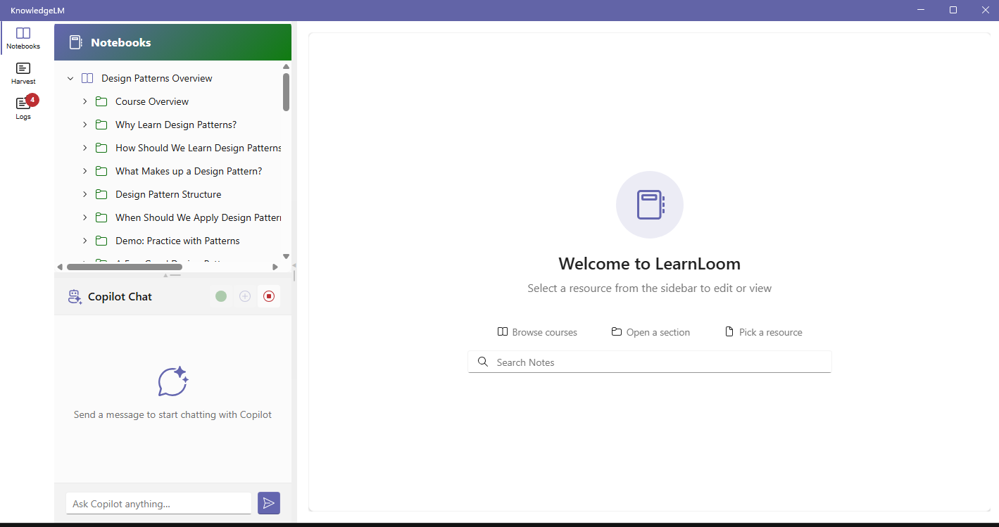
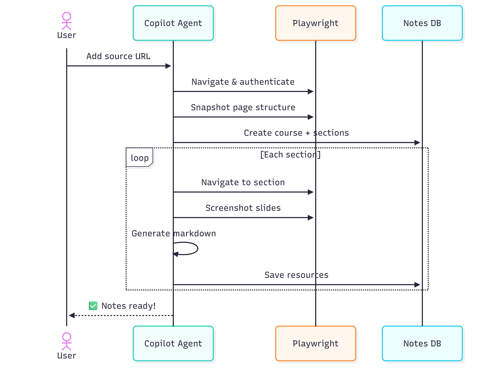
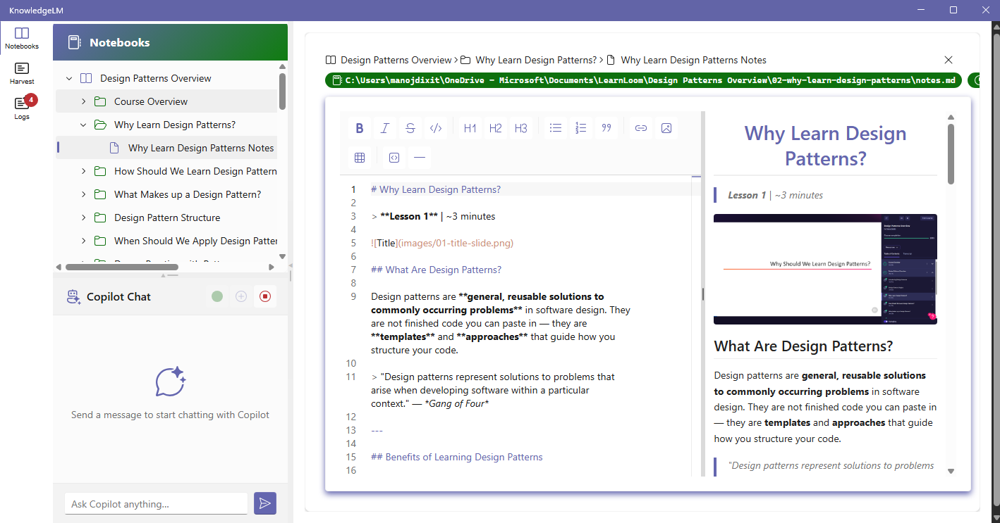
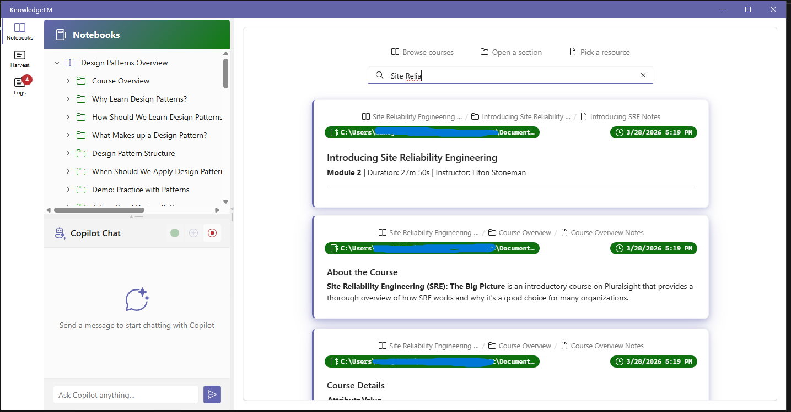
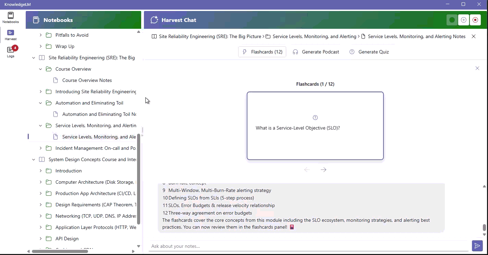
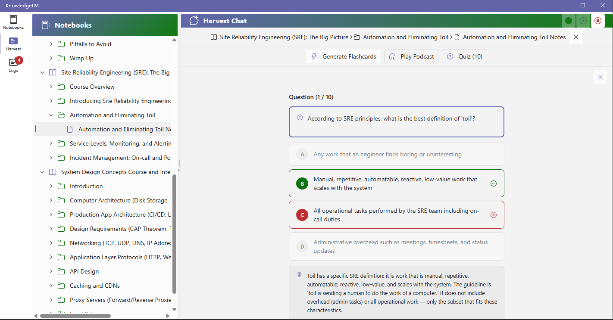
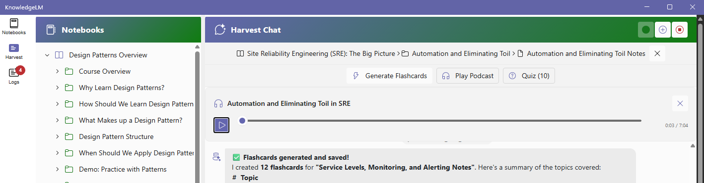
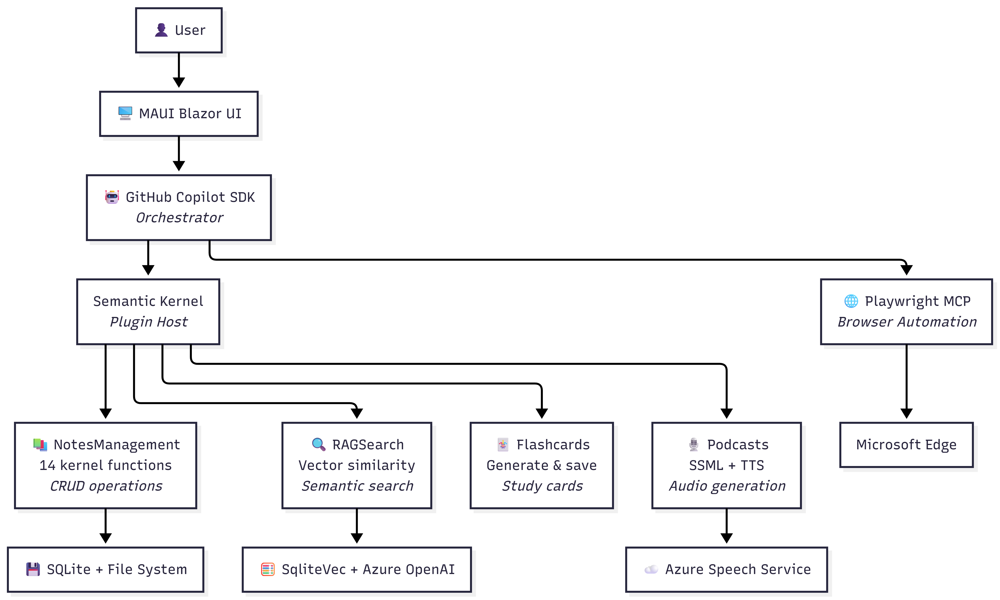
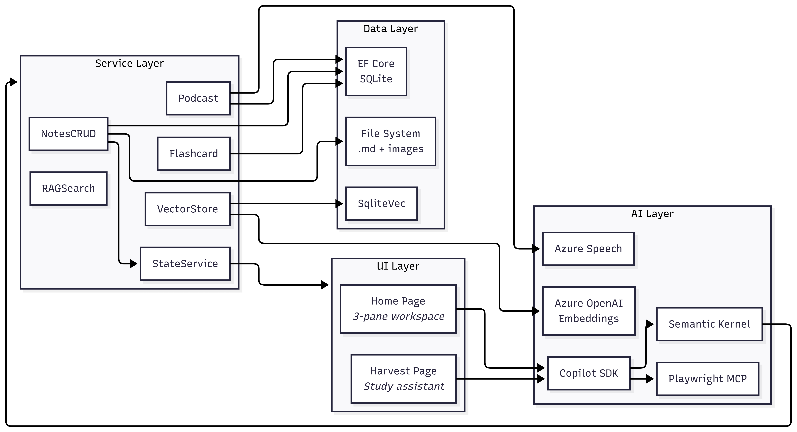

# 🎓 KnowledgeLM

> **AI-Agent-Powered Knowledge Management**
> *Capture · Organize · Harvest — from any content source.*

An AI agent that captures, organizes, and helps you retain knowledge from any public *or* private source — so you can focus entirely on learning while the agent takes the notes.

---

## The Problem

**Knowledge consumed ≠ Knowledge retained.**

Learners and professionals constantly consume content across fragmented platforms, but balancing note-taking with active learning is a losing battle:

- **70–90%** of knowledge is forgotten within a week
- **1.8 hrs/day** lost searching for information
- **4–6** fragmented learning platforms per person
- Existing tools (e.g., NotebookLM) only handle **public** sources — no SSO, no enterprise access
- Note-taking *competes* with comprehension

## The Solution

KnowledgeLM closes the loop across the full knowledge lifecycle:

| | |
|---|---|
| 📚 **Capture** | An AI agent navigates content, screenshots key moments, and generates structured Markdown notes autonomously |
| 📝 **Organize** | An Obsidian-like Monaco editor with split live preview, hierarchical TreeView navigation, and local-first `.md` storage |
| 🧠 **Harvest** | Chat with notes via RAG, auto-generated flashcards for spaced repetition, AI-narrated podcasts for on-the-go revision |
| 🌐 **Any Source** | LinkedIn Learning · Pluralsight · Microsoft Learn · SharePoint · YouTube · PDFs · Web |

---

## 📚 Capture — The Agent Does the Note-Taking

Two modes, both autonomous:

- **🎬 Read-Along Mode** — Notes generated in real-time while *you* browse content. The agent watches alongside you and captures screenshots at every key moment.
- **🛋️ Sit-Back & Relax Mode** — Provide a URL, walk away. The agent navigates the full course end-to-end and assembles a structured `Course → Section → Resource` folder hierarchy.

## 📝 Organize — Obsidian-Like Markdown Editor

- **Monaco Editor** with split live preview and full markdown toolbar (bold, italic, lists, tables, code blocks, mermaid diagrams)
- **Course → Section → Resource** hierarchy with TreeView navigation and context menus
- Screenshots and media embedded inline
- **Undo / Redo** via the Memento pattern
- **Local-first** — every note is a plain `.md` file on disk; full semantic search across them

## 🧠 Harvest — Turn Notes into Active Learning

Notes shouldn't just sit there. KnowledgeLM turns them into active-recall tools:

- **💬 RAG-Powered Q&A** — Ask questions about your notes; get answers with source citations from *your own* content
- **🃏 AI Flashcards** — Auto-generated Q&A cards for spaced repetition and self-assessment
- **🎙️ AI Podcasts** — Text-to-Speech episodes generated from notes, perfect for on-the-go revision
- **❓ Quizzes** — On-demand multiple-choice quizzes from any note

<table>
<tr>
<td></td>
<td></td>
</tr>
<tr>
<td align="center">AI-generated flashcards</td>
<td align="center">Auto-generated quizzes</td>
</tr>
</table>

---

## 🧠 Agent-First Architecture

The Copilot SDK agent is the *brain*. It reasons, plans, and invokes registered skills. Playwright is a tool the agent calls for browser automation, screenshots, and content extraction. Custom code is only written for capabilities Playwright can't provide (PDF parsing, YouTube API, perceptual hashing).

### System Component Diagram

> All AI capabilities flow through the **Copilot SDK agent** — there are no direct LLM API calls in application code.

---

## 🛠️ Tech Stack

| Layer | Technology |
|-------|-----------|
| **App Framework** | .NET MAUI Blazor Hybrid (Windows + Android) |
| **UI Components** | Fluent UI Blazor v4 |
| **AI Orchestrator** | GitHub Copilot SDK |
| **AI Plugins** | Semantic Kernel v1.73 |
| **Browser Automation** | Playwright MCP Server |
| **Markdown Editor** | Monaco Editor + Markdig |
| **Vector Search** | SqliteVec + Azure OpenAI Embeddings |
| **Speech / TTS** | Azure Cognitive Services |
| **Database** | EF Core 10 + SQLite |
| **Hosting** | .NET Aspire |
| **Observability** | OpenTelemetry |

---

## 🚀 Getting Started

See [docs/](docs/) for the implementation plan, architecture, and milestones:

- [`docs/architecture.md`](docs/architecture.md) — system design
- [`docs/implementation-plan.md`](docs/implementation-plan.md) — build plan
- [`docs/hackathon-pitch.md`](docs/hackathon-pitch.md) — full pitch deck (Marp)
- [`docs/milestones.md`](docs/milestones.md) — roadmap

---

## 📄 License

This project is licensed under the **GNU Affero General Public License v3.0 (AGPL-3.0)**.

You may use, modify, and redistribute it under the terms of that license. If you run a modified version of this software as a network service, you must make the complete source code of your modified version available to its users under the same license. See [LICENSE.txt](LICENSE.txt) for the full text.

---

<em>🎓 The AI agent captures the notes. You capture the knowledge.</em>

