# KnowledgeLM — Architecture

> **Last updated to match codebase state as of March 2026**

---

## System Overview

KnowledgeLM is a **.NET MAUI Blazor Hybrid** desktop application for AI-powered learning and note-taking. It combines **Microsoft Semantic Kernel** for AI plugin orchestration, **GitHub Copilot SDK** as the LLM interface, **Playwright MCP** for browser automation, and **Azure OpenAI** for vector embeddings and speech synthesis.

### High-Level Architecture

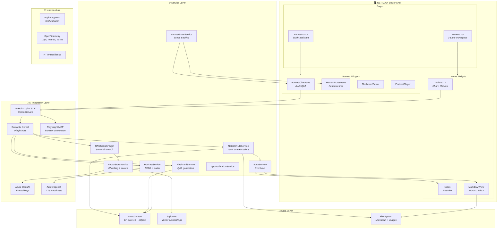

---

## Project Dependency Graph

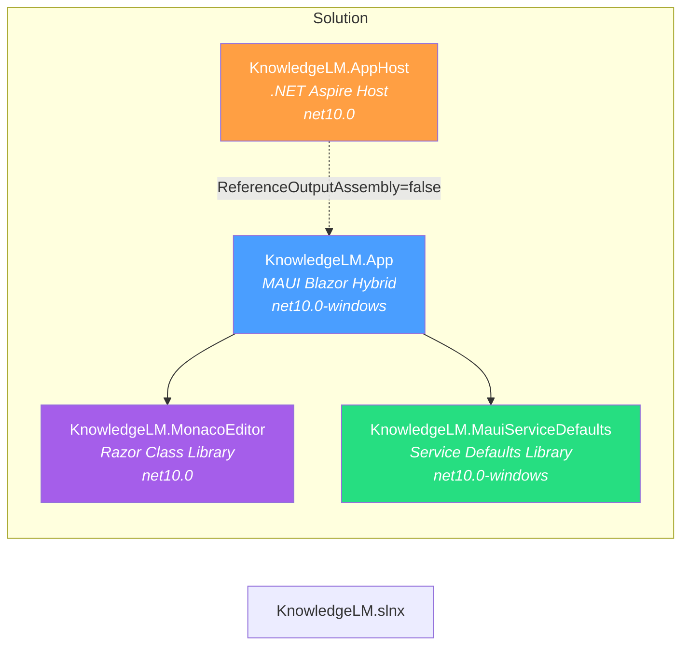

---

## Solution Structure

```
KnowledgeLM/
├── KnowledgeLM.slnx
├── docs/
│   ├── architecture.md                    # This file
│   ├── milestones.md
│   ├── implementation-plan.md
│   ├── feasibility.md
│   ├── local-content-loading-plan.md
│   ├── markdown-editor-viewer-options.md
│   └── todo.md
│
└── src/
    ├── KnowledgeLM.App/                              # Main MAUI Blazor application
    │   ├── Components/
    │   │   ├── Pages/
    │   │   │   ├── Home.razor                         # @page "/" — 3-pane workspace
    │   │   │   ├── Harvest.razor                      # @page "/Harvest" — Study assistant
    │   │   │   └── NotFound.razor
    │   │   ├── Layout/
    │   │   │   ├── MainLayout.razor                   # FluentLayout shell
    │   │   │   └── NavMenu.razor                      # FluentAppBar sidebar
    │   │   ├── Widgets/
    │   │   │   ├── Notes.razor(.cs/.js)               # Course → Section → Resource tree
    │   │   │   ├── GithubCLI.razor(.cs/.js)           # Copilot chat + web harvesting
    │   │   │   ├── MarkDownView.razor(.cs)            # Monaco editor wrapper
    │   │   │   ├── HarvestChatPane.razor(.cs)         # RAG Q&A chat
    │   │   │   ├── HarvestNotesPane.razor(.cs)        # Resource tree with vectorization
    │   │   │   ├── FlashcardViewer.razor(.cs)         # Flip card study UI
    │   │   │   └── PodcastPlayer.razor(.cs)           # Audio playback
    │   │   ├── Routes.razor
    │   │   └── _Imports.razor
    │   ├── Data/
    │   │   └── NotesContext.cs                         # EF Core DbContext
    │   ├── Models/
    │   │   ├── Notes/
    │   │   │   ├── CommonItemProperties.cs            # Abstract base entity
    │   │   │   ├── Course.cs / Section.cs / Resource.cs
    │   │   │   ├── ResourceType.cs                    # Enum: Image, Video, Other, Markdown
    │   │   │   └── DTOs/                              # CourseDto, SectionDto, ResourceDto, etc.
    │   │   ├── AI/
    │   │   │   ├── VectorizedResource.cs              # Vectorization tracking
    │   │   │   ├── Flashcard.cs                       # Q&A pairs
    │   │   │   ├── Podcast.cs                         # Audio metadata
    │   │   │   └── NoteChunk.cs                       # Vector store record (1536-dim)
    │   │   └── CoPilotMessages.cs                     # Chat message model
    │   ├── Services/
    │   │   ├── NotesCRUDService.cs                    # CRUD + Semantic Kernel plugin
    │   │   ├── CopilotService.cs                      # GitHub Copilot SDK wrapper
    │   │   ├── VectorStoreService.cs                  # Embedding + semantic search
    │   │   ├── RAGSearchPlugin.cs                     # Semantic Kernel RAG plugin
    │   │   ├── FlashcardService.cs                    # Flashcard generation plugin
    │   │   ├── PodcastService.cs                      # Podcast generation plugin
    │   │   ├── StateService.cs                        # Global event bus
    │   │   ├── HarvestStateService.cs                 # Study scope tracking
    │   │   └── AppNotificationService.cs              # Toast notifications
    │   ├── Helpers/
    │   │   ├── AgentPrompts.cs                        # System prompt + MCP config
    │   │   └── ManagedStream.cs                       # Stream wrapper for WebView
    │   ├── MauiProgram.cs                             # DI, DB init, Kernel setup
    │   ├── MainPage.xaml(.cs)                         # BlazorWebView + WebResourceRequested
    │   ├── App.xaml(.cs)                              # MAUI app entry
    │   ├── appsettings.json                           # Azure OpenAI + Speech config
    │   └── wwwroot/                                   # index.html, CSS
    │
    ├── KnowledgeLM.MonacoEditor/                      # Razor Class Library
    │   ├── Components/
    │   │   ├── MonacoMarkdownEditor.razor(.cs)        # Split editor + preview
    │   │   └── MarkdownToolbar.razor(.cs)             # Formatting actions
    │   ├── Extensions/
    │   │   └── ServiceCollectionExtensions.cs          # DI: AddMonacoEditorPack()
    │   ├── Markdown/
    │   │   ├── MarkdownPipelineFactory.cs             # Markdig pipeline config
    │   │   └── MarkdownOptions.cs
    │   ├── Memento/
    │   │   ├── TextEditorSession.cs                   # Undo/redo session
    │   │   ├── TextOriginator.cs / TextMemento.cs / TextHistory.cs
    │   │   └── IMemento.cs
    │   ├── Monaco/
    │   │   └── MonacoOptions.cs                       # Editor configuration
    │   └── wwwroot/js/
    │       ├── monacoMarkdownEditor.js                # Editor lifecycle + interop
    │       ├── monacoMarkdownToolbar.js               # Toolbar JS actions
    │       ├── monaco-editor-pack.js                  # CDN loader (v0.52.2)
    │       ├── fluentUIDesignTokens.js                # Fluent UI token extraction
    │       └── cssClassHarvester.js                   # CSS IntelliSense
    │
    ├── KnowledgeLM.AppHost/                           # .NET Aspire orchestration
    │   └── AppHost.cs                                 # AddMauiProject + AddWindowsDevice
    │
    └── KnowledgeLM.MauiServiceDefaults/               # Shared service config
        └── Extensions.cs                              # OpenTelemetry, resilience, discovery
```

---

## Tech Stack

| Layer | Technology | Status |
|-------|-----------|--------|
| App Framework | .NET 10 MAUI Blazor Hybrid | ✅ Implemented |
| UI Components | Microsoft FluentUI Blazor (v4.14) | ✅ Implemented |
| Markdown Editor | Monaco Editor v0.52.2 (CDN) + Markdig | ✅ Implemented |
| AI Orchestration | Microsoft Semantic Kernel (v1.73) | ✅ Implemented |
| AI Agent | GitHub Copilot SDK (v0.1.30) | ✅ Implemented |
| AI Extensions | Microsoft.Extensions.AI (v10.3) | ✅ Implemented |
| Vector Search | SqliteVec + Azure OpenAI Embeddings (text-embedding-ada-002) | ✅ Implemented |
| Speech Synthesis | Azure Cognitive Services Speech (v1.48.2) — SSML | ✅ Implemented |
| Browser Automation | Playwright MCP Server (@playwright/mcp, MS Edge) | ✅ Implemented |
| Audio Playback | Plugin.Maui.Audio (v4.0) | ✅ Implemented |
| Database | EF Core 10 + SQLite | ✅ Implemented |
| Hosting | .NET Aspire AppHost (v13.1.2) | ✅ Implemented |
| Observability | OpenTelemetry (logging, metrics, tracing) | ✅ Implemented |
| HTTP Resilience | Microsoft.Extensions.Http.Resilience | ✅ Implemented |
| HTML Sanitization | HtmlSanitizer (v9.0) | ✅ Implemented |

---

## Data Model

### Entity Relationship Diagram

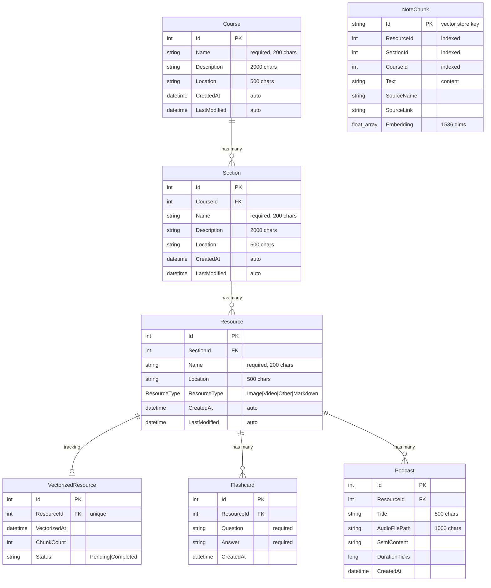

### Database Layout

| Database | Engine | Purpose |
|----------|--------|---------|
| `knowledgelm.db` | SQLite (EF Core) | Core entities: Courses, Sections, Resources, VectorizedResources, Flashcards, Podcasts |
| `knowledgelm_vectors.db` | SQLite + SqliteVec | Vector embeddings: `note_chunks` collection (1536-dim, Azure OpenAI) |

---

## AI Agent Architecture

### Copilot Session & Tool Flow

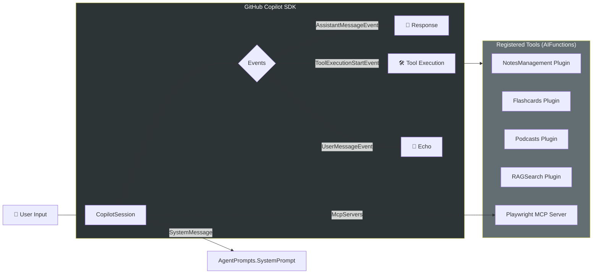

### Semantic Kernel Plugins

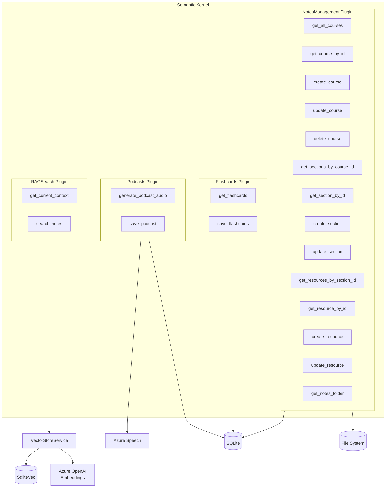

### MCP Server Configuration

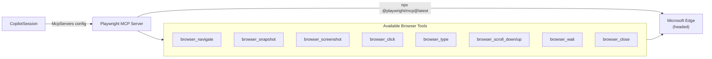

---

## Application Workflows

### Web Harvesting (Home Page)

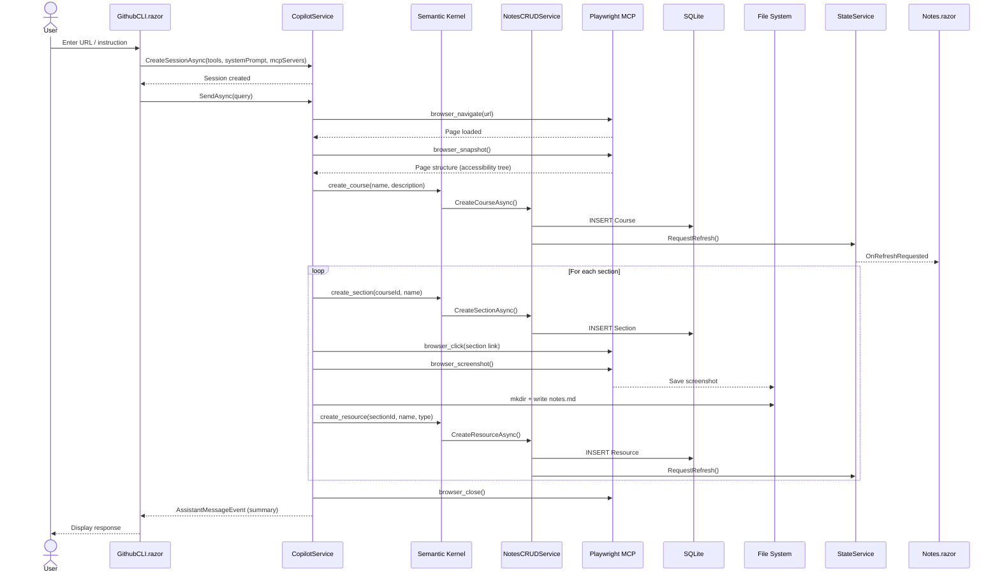

### Study Assistant (Harvest Page)

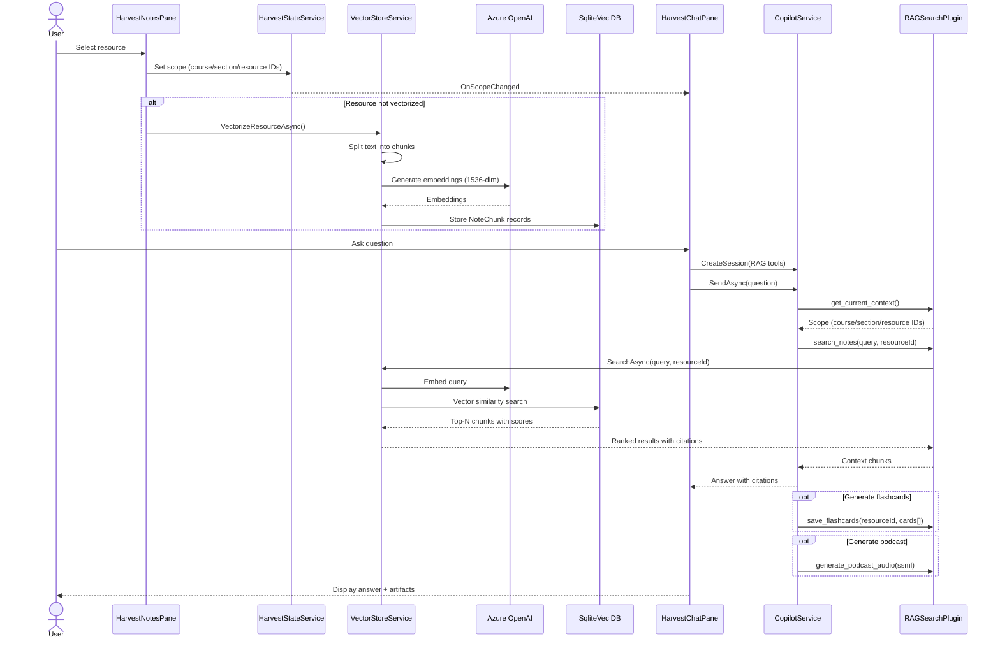

### Flashcard & Podcast Generation

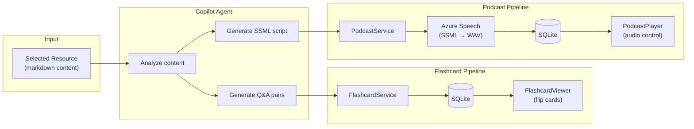

---

## State Management

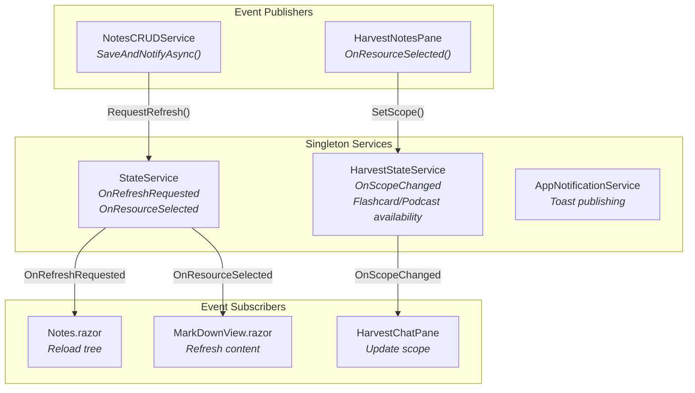

---

## Monaco Editor Architecture

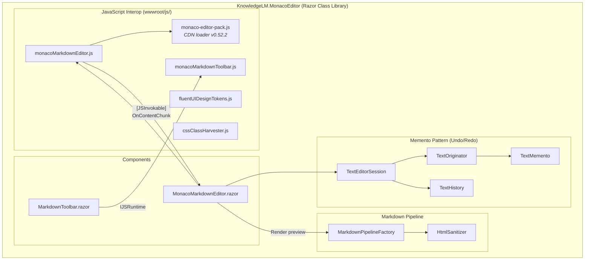

---

## DI Registration (MauiProgram.cs)

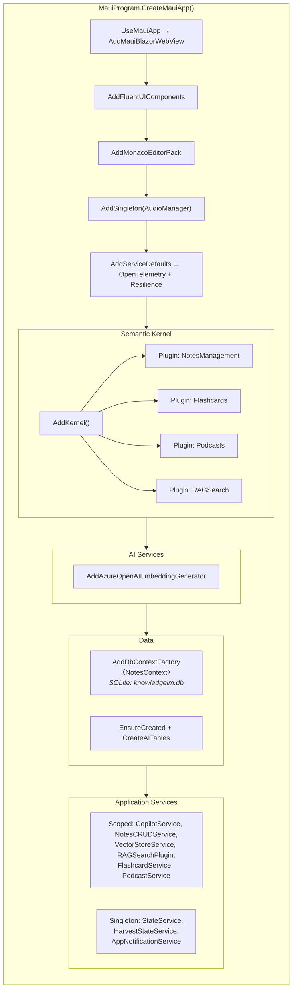

---

## UI Component Map

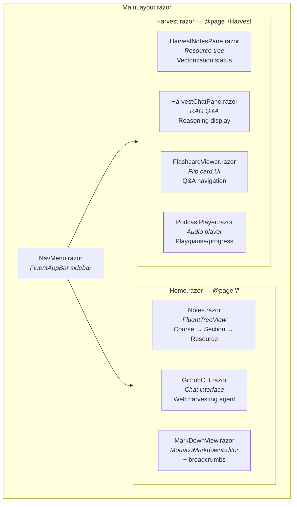

---

## Web Resource Interception

`MainPage.xaml.cs` intercepts `WebResourceRequested` events to serve local files into the Blazor WebView:

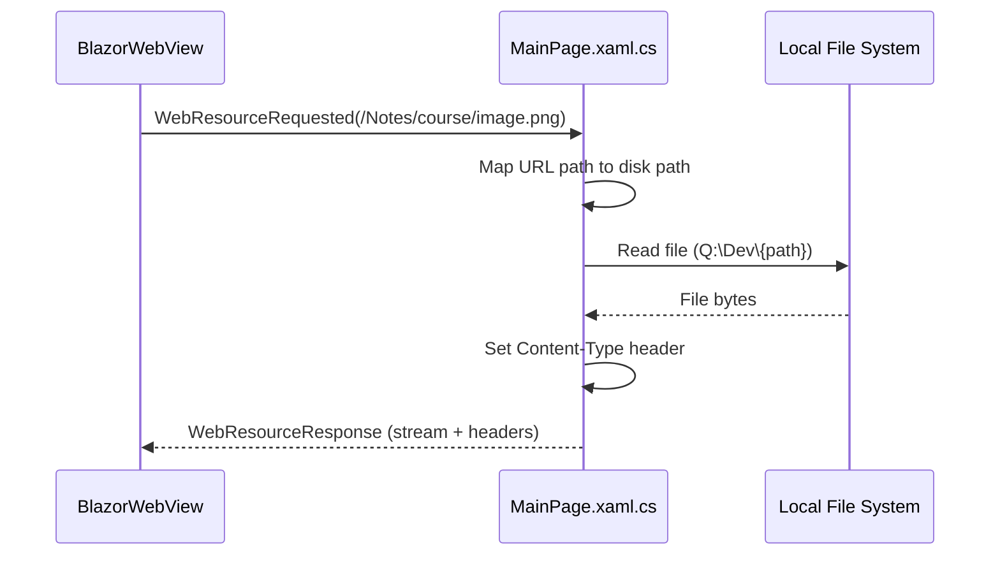

---

## Design Patterns

| Pattern | Implementation | Purpose |
|---------|---------------|---------|
| **Memento** | `TextEditorSession` / `TextHistory` / `TextMemento` | Undo/redo in Monaco editor |
| **Factory** | `IDbContextFactory<NotesContext>` | Concurrency-safe EF Core contexts in Blazor |
| **Observer** | `StateService` / `HarvestStateService` events | Reactive UI updates across components |
| **Plugin** | `[KernelFunction]` attributes on services | Expose C# methods as AI-callable tools |
| **MCP** | Playwright MCP Server (JSON-RPC) | Extensible browser automation for AI agent |
| **Repository** | `NotesCRUDService` | Abstract data access behind kernel functions |
| **Memento + Command** | `MonacoMarkdownToolbar` JS actions | Editor formatting with undo support |

---

## Configuration

### appsettings.json

```json
{
  "AzureOpenAI": {
    "Endpoint": "",
    "ApiKey": "",
    "EmbeddingDeployment": "text-embedding-3-small"
  },
  "AzureSpeech": {
    "Key": "",
    "Region": ""
  }
}
```

### Hardcoded Values

> ⚠️ These values are currently hardcoded and should be moved to app settings:

| Setting | Value | Location |
|---------|-------|----------|
| Copilot CLI path | `C:\Users\manojdixit\AppData\Local\Microsoft\WinGet\Links\copilot.exe` | `GithubCLI.razor.cs` |
| Notes folder | `D:\Dev\LearnLoom` | `AgentPrompts.cs` |
| Web resource root | `Q:\Dev\` | `MainPage.xaml.cs` |
| Title bar color | `#6264A7` | `MainPage.xaml.cs` |

---

## Future Vision (Not Yet Implemented)

See `docs/implementation-plan.md` for the original design vision.

### Planned Features

- **Sit-Back Mode** — Agent autonomously navigates courses and generates notes
- **Read-Along Mode** — Real-time note capture while learner browses
- **Quiz Generation** — Auto-generate quizzes from notes
- **Android Reader** — Mobile app for consuming notes, chat, quiz (no scraping)

### Planned Capabilities

| Capability | Purpose | Status |
|------------|---------|--------|
| PDF Processing | PdfPig/iText7 text extraction | ❌ Planned |
| YouTube Transcripts | YouTube Data API v3 | ❌ Planned |
| Screenshot Analysis | Perceptual hashing for slide change detection | ❌ Planned |
| Authentication | Enterprise SSO for LinkedIn Learning, Pluralsight, etc. | ❌ Planned |
