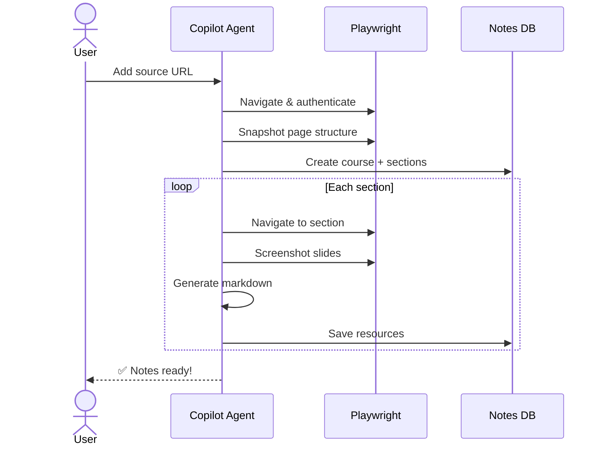
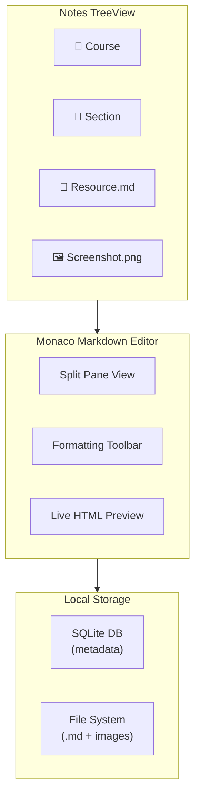
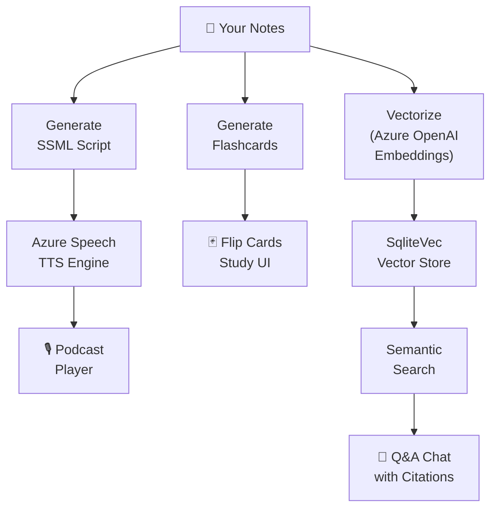
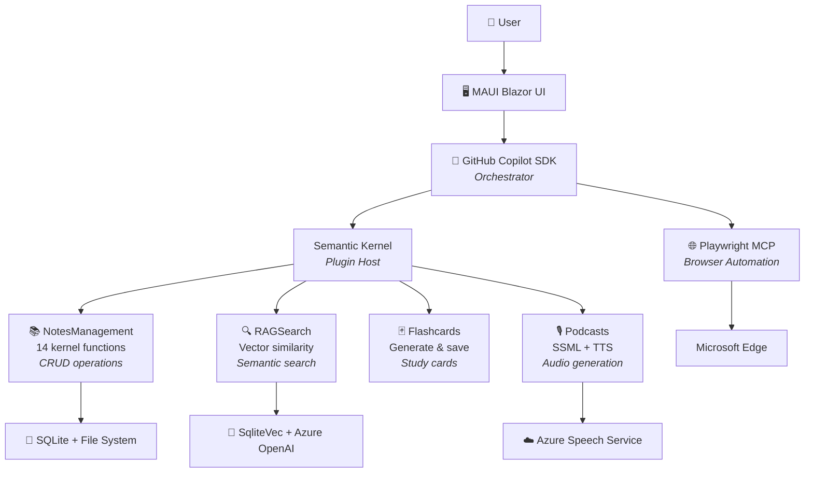
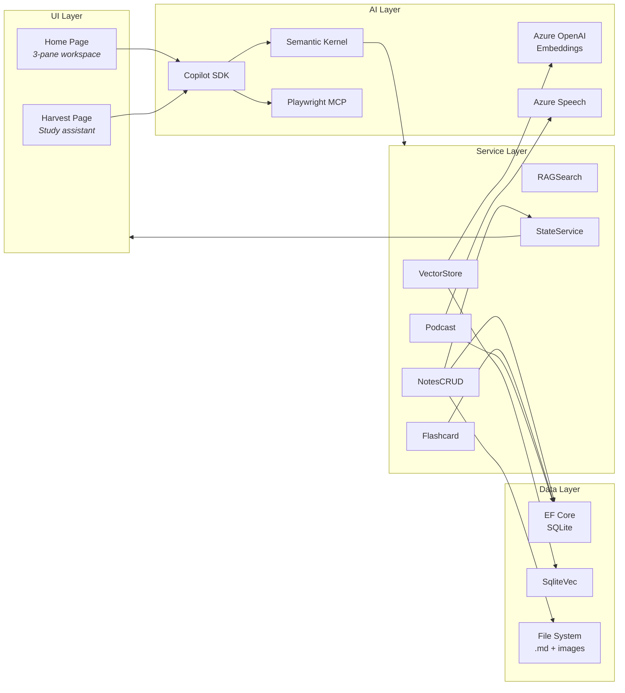

<!-- _paginate: false -->
<!-- _class: lead -->

# 🎓 LearnLoom

## AI-Agent-Powered Knowledge Management

*Capture · Organize · Harvest — from any content source*

 

GitHub Copilot SDK
Semantic Kernel
Playwright MCP
.NET MAUI Blazor
Azure OpenAI

 

*Hackathon Demo · March 2026*

---

# The Problem

## Knowledge consumed ≠ Knowledge retained

Learners and professionals constantly consume content across **fragmented platforms** — but balancing note-taking with active learning is a losing battle.

### 😫 Pain Points

- **70–90%** of knowledge forgotten within a week
- Note-taking **competes** with comprehension
- **1.8 hrs/day** lost searching for information
- **4–6** fragmented learning platforms
- No tool captures from **enterprise** sources

### 🚫 Existing Tools Fall Short

- NotebookLM → **public sources only**
- No SSO/enterprise platform access
- Manual upload required
- No structured note generation
- No active learning features

---

# The Solution

## LearnLoom — Full-Lifecycle Knowledge Management

> An **AI agent** that captures, organizes, and helps you retain knowledge — so you can focus entirely on learning.

### 📚 Capture
AI agent navigates, screenshots, extracts, and generates structured Markdown notes **autonomously**

### 📝 Organize
Obsidian-like editor with full control. Notes as `.md` files with screenshots and metadata

### 🧠 Harvest
Chat with notes via **RAG**, generate **flashcards** for self-assessment, create **AI podcasts** for on-the-go revision

### 🌐 Any Source
LinkedIn Learning · Pluralsight · Microsoft Learn · SharePoint · YouTube · PDFs · Web

---

# Capture

## AI Agent Does the Note-Taking

### 🎬 Read-Along Mode
Notes generated **in real-time** while you consume content
- You browse at your pace
- Agent captures alongside you
- Screenshots at every key moment

### 🛋️ Sit-Back & Relax Mode
Agent navigates courses **autonomously**
- Provide a URL, walk away
- Full course captured end-to-end
- Structured folder hierarchy created

---

# Organize

## Obsidian-Like Markdown Editor

### ✨ Features

- **Monaco Editor** with split live preview
- Full **Markdown toolbar** — bold, italic, lists, tables, code blocks
- **Course → Section → Resource** hierarchy
- **TreeView** navigation with context menus
- Screenshots and media embedded inline
- **Undo/Redo** with Memento pattern
- Local-first — all files on disk

---

# Harvest

## Turn Notes into Active Learning

### 💬 RAG-Powered Q&A
Ask questions about your notes — get answers with **source citations** from your own content

### 🃏 AI Flashcards
Auto-generated **Q&A cards** for spaced repetition and self-assessment

### 🎙️ AI Podcasts
**Text-to-Speech** podcast episodes generated from your notes for on-the-go revision

---

# Agent-First Architecture

## The AI Agent Is the Brain

> The agent **reasons, plans, and invokes** registered skills. Custom code only exists for capabilities the agent + Playwright can't provide.

---

# Architecture Deep Dive

## System Component Diagram

---

# Tech Stack

| Layer | Technology |
|-------|-----------|
| **App Framework** | .NET MAUI Blazor Hybrid |
| **UI Components** | Fluent UI Blazor v4 |
| **AI Orchestrator** | GitHub Copilot SDK |
| **AI Plugins** | Semantic Kernel v1.73 |
| **Browser Automation** | Playwright MCP Server |
| **Vector Search** | SqliteVec + Azure OpenAI |

| Layer | Technology |
|-------|-----------|
| **Markdown Editor** | Monaco Editor + Markdig |
| **Speech / TTS** | Azure Cognitive Services |
| **Database** | EF Core 10 + SQLite |
| **Hosting** | .NET Aspire |
| **Observability** | OpenTelemetry |
| **Target Platforms** | Windows + Android |

 

*All AI capabilities are provided through the* **Copilot SDK agent** *— no direct LLM API calls in application code*

---

# Impact

## Solving Real Problems at Scale

70–90%

knowledge forgotten in a week

→ Structured notes + spaced retrieval via quizzes and RAG Q&A

1.8 hrs

per day lost searching

→ Centralized notebooks with semantic search

$31.5B

annual enterprise knowledge loss

→ Persistent knowledge base that survives transitions

Zero

cognitive load on learner

→ Agent captures notes autonomously

4–6

fragmented platforms unified

→ Single tool for all content sources

Active

learning, not passive consumption

→ Quizzes, podcasts, and conversational review

---

# Why LearnLoom Matters

## AI-Forward Engineering

### 🏗️ Architecture Philosophy

The AI agent **isn't a feature bolted on** — it's the **core orchestrator**.

- Agent **reasons and plans** the capture workflow
- Agent **invokes tools** (Playwright, CRUD, Search)
- Agent **decides** what to capture and how to structure
- Custom code only where agent + Playwright can't reach

### 🎯 Built With AI, For AI-Assisted Learning

Every interaction — from capture to quiz to podcast — flows through the intelligent agent.

```mermaid
graph TB
    subgraph Traditional["Traditional Approach"]
        T1["Hard-coded scraper"]
        T2["Manual note templates"]
        T3["Static quiz builder"]
        T4["Separate tools"]
    end

    subgraph LearnLoom["LearnLoom Approach"]
        A["🤖 Copilot Agent"]
        A --> S1["Adaptive navigation"]
        A --> S2["Intelligent note structure"]
        A --> S3["Context-aware Q&A"]
        A --> S4["Unified experience"]
    end

    style Traditional fill:#1a1a2e,stroke:#30363d
    style LearnLoom fill:#0d2137,stroke:#58a6ff
```

---

# Data Flow

## End-to-End Knowledge Pipeline

```mermaid
flowchart LR
    subgraph Capture["📥 CAPTURE"]
        URL["Source URL"]
        URL --> PW2["Playwright MCP<br/>Navigate + Auth"]
        PW2 --> SS["Screenshots"]
        PW2 --> Text["Text Extraction"]
    end

    subgraph Organize["📝 ORGANIZE"]
        SS --> MD2["Markdown Notes"]
        Text --> MD2
        MD2 --> DB2["SQLite<br/>(Course/Section/Resource)"]
        MD2 --> FS3["Disk<br/>(.md + .png)"]
    end

    subgraph Harvest["🧠 HARVEST"]
        MD2 --> Chunk["Chunk + Embed"]
        Chunk --> VecDB2["Vector DB"]
        VecDB2 --> Search["Semantic Search"]
        Search --> QA2["💬 Q&A Chat"]
        MD2 --> Cards["🃏 Flashcards"]
        MD2 --> Podcast2["🎙️ Podcast"]
    end

    style Capture fill:#1a2332,stroke:#58a6ff
    style Organize fill:#1a2a1a,stroke:#7ee787
    style Harvest fill:#2a1a1a,stroke:#f0883e
```

---

<!-- _class: lead -->

# Demo Time! 🚀

 

**Capture** → Point the agent at a Microsoft Learn module

**Organize** → Browse generated notes in the editor

**Harvest** → Ask questions, generate flashcards, listen to podcast

 

📚

Capture

→

📝

Organize

→

🧠

Harvest

---

<!-- _paginate: false -->
<!-- _class: lead -->

# Thank You

## LearnLoom — Learn More, Note Less

 

.NET MAUI Blazor
GitHub Copilot SDK
Semantic Kernel
Playwright MCP
Azure OpenAI
Azure Speech
SqliteVec
.NET Aspire

 

*🎓 AI agent captures the notes. You capture the knowledge.*
